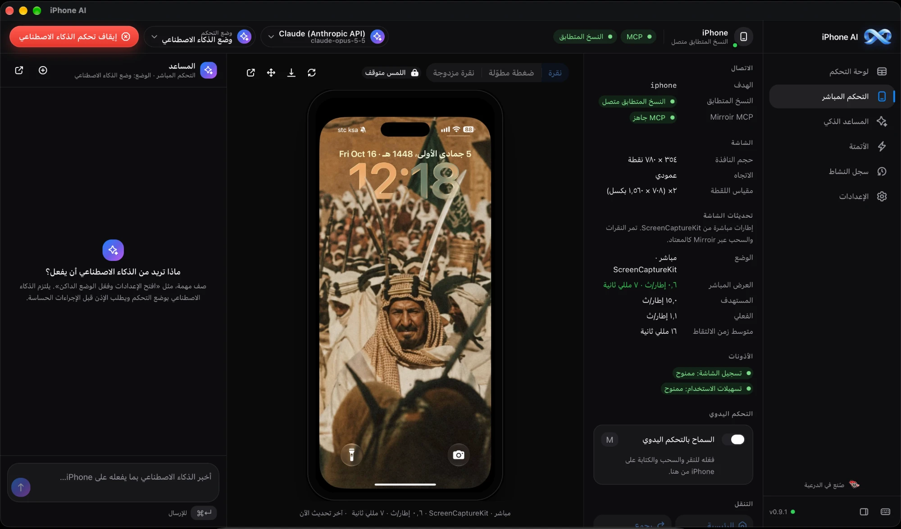
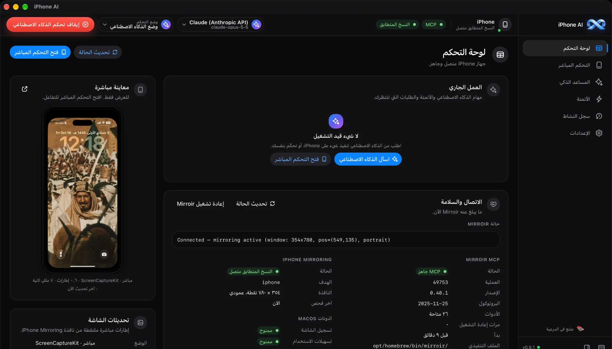
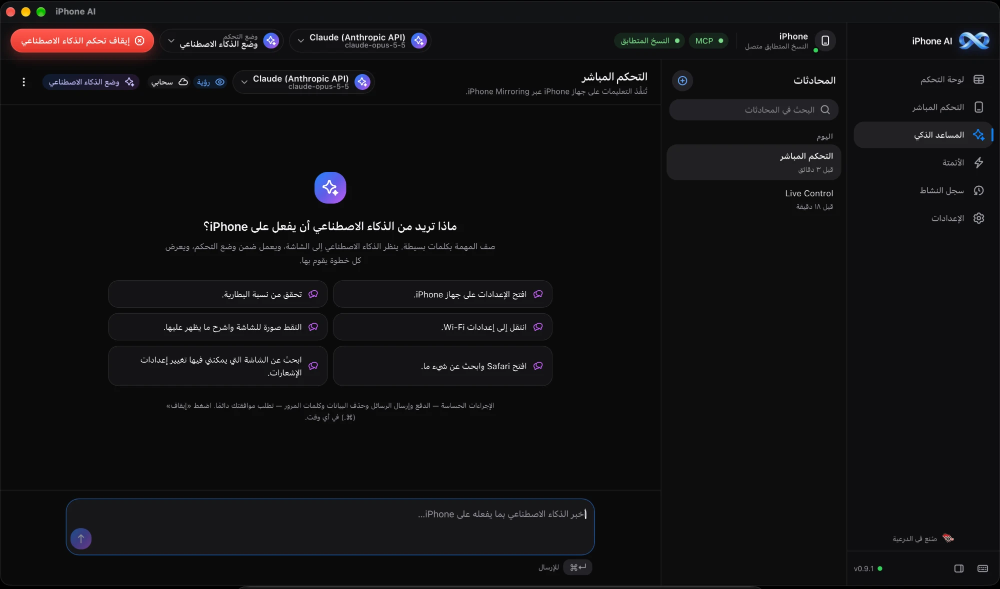
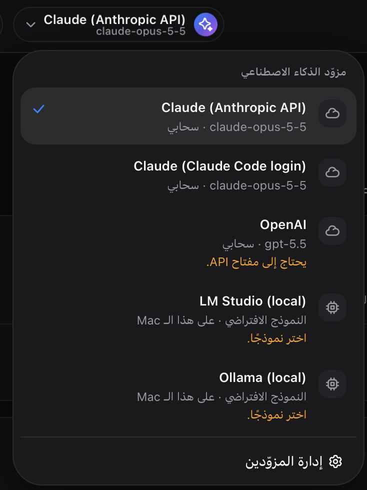
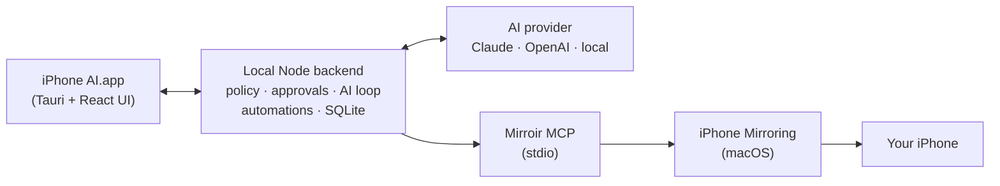

<div align="center">


# iPhone AI

**Control your real iPhone from your Mac — by hand, or let AI do it for you.**

**تحكّم في جهاز iPhone الحقيقي من جهاز Mac — بيدك، أو دع الذكاء الاصطناعي ينجز المهمة عنك.**

[](#requirements)
[](#requirements)
[](https://github.com/fmsfmsfms/iphone-ai/commits/main)
[](LICENSE)
[](#arabic)

[English](#english) · [العربية](#arabic)



</div>

<a id="english"></a>

## What is iPhone AI?

iPhone AI is a Mac app that shows your **physical iPhone** live on your Mac and lets you
control it — **by hand**, with an **AI agent** (Claude, OpenAI or a model running on your own
Mac), or with **saved automations**.

It works through Apple's **iPhone Mirroring** and the **[Mirroir MCP](https://mirroir.dev/)**
server. Nothing to install on the phone, no jailbreak.

> *"Open Settings and turn on Dark Mode."* — the AI looks at the real screen, taps one step at a
> time, re-checks the screen after every action, and confirms the result.

## Features

- **Live Control** — the iPhone screen live on your Mac (ScreenCaptureKit, up to 15 fps, with
  honest FPS and latency figures). Tap, double-tap, long-press, swipe, type, and use Home,
  Back and the App Switcher from a phone-shaped viewer. Paged feeds like TikTok scroll with a
  tuned glide swipe.
- **AI Assistant** — describe a task in plain words: *"Check my battery percentage"*,
  *"Navigate to Wi-Fi settings"*. The AI observes the screen, acts one step at a time, and
  verifies the final result against what is actually visible.
- **Bring your own AI** — Claude (Anthropic API or your Claude Code login), OpenAI, or local
  models through LM Studio, Ollama or any OpenAI-compatible server. Switch in one click.
- **Automations** — save and re-run workflows. Steps are found by on-screen text, not
  hard-coded coordinates, with AI suggestions, manual recording and approval checkpoints.
- **Activity History** — every action is logged: who did it, when, and why.
- **English and Arabic** with full right-to-left layout, plus an optional **private remote
  dashboard** (for example over Tailscale). The Mac always stays the control host.

## Screenshots

<table>
  <tr>
    <td width="50%" valign="top">
      
      <p><b>Dashboard</b> — connection health, macOS permissions, running tasks and a live preview at a glance.</p>
    </td>
    <td width="50%" valign="top">
      
      <p><b>AI Assistant</b> — type what you want done; the AI watches the screen and shows every step it takes.</p>
    </td>
  </tr>
</table>

<table>
  <tr>
    <td width="38%" valign="top">
      
    </td>
    <td valign="top">
      <h3>Pick your AI provider</h3>
      <ul>
        <li><b>Claude</b> — with an Anthropic API key, or your signed-in Claude Code (personal use)</li>
        <li><b>OpenAI</b> — with an OpenAI API key</li>
        <li><b>LM Studio</b> and <b>Ollama</b> — models that run locally on your Mac</li>
        <li>Any <b>OpenAI-compatible</b> server (vLLM and others)</li>
      </ul>
      <p>Cloud providers are clearly marked, so you always know when the screen leaves your Mac.</p>
    </td>
  </tr>
</table>

## Control modes

You decide how much the AI is allowed to do, and you can change it at any time.

| Mode | What the AI can do |
|---|---|
| **Observe Only** *(default)* | Looks at the screen and answers questions. No taps, swipes or typing. |
| **Assisted** | Proposes each action as an approval card. Nothing happens until you approve it. |
| **AI Mode** | Taps, swipes and types on its own to finish the task, without asking first. |

Always on, in every mode:

- **Blocked apps** — banking, wallets and password managers stay off limits.
- **No typing on password or verification-code screens.**
- A big **Stop AI Control** button (<kbd>⌘</kbd> <kbd>.</kbd>) that halts the AI immediately.
- Limits on actions and time for every task, and a full audit trail.
- Assisted and AI Mode can only be switched on from the Mac itself, never remotely.

## How it works



The backend runs only on your Mac. It launches your installed Mirroir binary with its own
configuration and never modifies Mirroir or `~/.mirroir-mcp`.

## Requirements

- A Mac with **Apple silicon** and **macOS 15** or later, with **iPhone Mirroring** set up
  (Apple's conditions apply: iPhone locked and nearby, same Apple Account, Wi-Fi and
  Bluetooth on).
- **[Mirroir](https://mirroir.dev/)** installed at `/opt/homebrew/bin/mirroir`.
- macOS permissions for iPhone AI: **Screen Recording**, **Accessibility**, and
  **Automation → System Events** (asked on first use).
- For AI: an Anthropic or OpenAI API key, a signed-in Claude Code, or a local
  OpenAI-compatible server (LM Studio, Ollama, vLLM).
- To build: Node.js 22.13+, pnpm 10, the Rust toolchain and the Xcode Command Line Tools.

## Install

There is no prebuilt download yet; build it from source:

```bash
git clone https://github.com/fmsfmsfms/iphone-ai.git
cd iphone-ai
pnpm install
pnpm package:mac -- --install   # builds, signs and installs /Applications/iPhone AI.app
open "/Applications/iPhone AI.app"
```

Then follow **Dashboard → Setup checklist**. Full guide: [docs/SETUP.md](docs/SETUP.md).

> [!NOTE]
> Always launch the copy in **/Applications**. macOS stops an app inside `~/Documents`,
> `~/Desktop` or `~/Downloads` from reading its own bundled server.
>
> Without an Apple Development or Developer ID certificate the app is ad-hoc signed, and macOS
> asks for its permissions again after every rebuild. Set `APPLE_SIGNING_IDENTITY` (or install a
> free Apple Development certificate through Xcode) to keep them.

Development, with a hot-reloading backend and Vite:

```bash
pnpm dev
```

## Documentation

- [Setup & usage](docs/SETUP.md)
- [Architecture](docs/ARCHITECTURE.md) — including the Mirroir behaviours that shaped the design
- [Security & privacy](docs/SECURITY.md)
- [Local API](docs/API.md)
- [Troubleshooting](docs/TROUBLESHOOTING.md)
- [Testing & verification report](docs/TESTING.md)
- [Known limitations](docs/KNOWN_LIMITATIONS.md)

<details>
<summary><b>Repository layout</b></summary>

| Path | Contents |
|---|---|
| `packages/shared` | Typed API contract, zod schemas, safe defaults |
| `packages/server` | Backend: MCP client, device control lane, policy, approvals, AI providers & agent loop, workflows, HTTP/WebSocket API, SQLite |
| `packages/web` | UI (React 19, Vite, Tailwind 4, HeroUI v3) |
| `src-tauri` | macOS app shell (Tauri 2) |
| `scripts` | Dev runner, packaging, icon generator, version bump |

</details>

---

<a id="arabic"></a>

<div dir="rtl">

## ما هو iPhone AI؟

**iPhone AI** تطبيق لأجهزة Mac يعرض جهاز **iPhone الحقيقي** مباشرة على شاشة الـ Mac ويتيح لك
التحكم فيه **بيدك**، أو عبر **وكيل ذكاء اصطناعي** (Claude أو OpenAI أو نموذج يعمل على جهازك)،
أو بـ**أتمتة محفوظة** تعيد تشغيلها متى شئت.

يعمل التطبيق عبر ميزة **النسخ المتطابق لـ iPhone** من Apple وخادم **[Mirroir MCP](https://mirroir.dev/)**،
فلا حاجة لتثبيت أي شيء على الهاتف ولا لكسر الحماية.

> «افتح الإعدادات وفعّل الوضع الداكن» — ينظر الذكاء الاصطناعي إلى الشاشة الحقيقية، وينفّذ خطوة
> واحدة في كل مرة، ويعيد فحص الشاشة بعد كل إجراء، ثم يتحقق من النتيجة.

## المزايا

- **التحكم المباشر** — شاشة الهاتف أمامك مباشرة (عبر ScreenCaptureKit حتى ١٥ إطارًا في الثانية،
  مع أرقام صادقة للأداء وزمن الاستجابة). انقر وانقر مرتين واضغط مطوّلًا واسحب واكتب، واستخدم
  أزرار الرئيسية والرجوع وتبديل التطبيقات. وتتنقّل الصفحات المتتالية مثل TikTok بسحبة انسيابية مضبوطة.
- **المساعد الذكي** — صِف المهمة بكلمات بسيطة: «تحقق من نسبة البطارية»، «انتقل إلى إعدادات Wi-Fi».
  يراقب الذكاء الاصطناعي الشاشة، وينفّذ خطوة واحدة في كل مرة، ويتحقق من النتيجة النهائية بما يظهر فعلًا.
- **اختر الذكاء الاصطناعي الذي تريده** — Claude (بمفتاح Anthropic API أو بتسجيل دخولك في Claude Code)،
  أو OpenAI، أو نماذج محلية عبر LM Studio وOllama وأي خادم متوافق مع OpenAI. التبديل بنقرة واحدة.
- **الأتمتة** — احفظ سير العمل وأعد تشغيله. تُحدَّد الخطوات بالنص الظاهر على الشاشة لا بإحداثيات
  ثابتة، مع اقتراحات من الذكاء الاصطناعي وتسجيل يدوي ونقاط موافقة.
- **سجل النشاط** — كل إجراء مسجَّل: من نفّذه، ومتى، ولماذا.
- **واجهة عربية وإنجليزية** بدعم كامل للاتجاه من اليمين إلى اليسار، مع **لوحة تحكم خاصة عن بُعد**
  اختيارية (مثلًا عبر Tailscale)، ويبقى الـ Mac دائمًا هو جهاز التحكم.

## أوضاع التحكم

أنت من يحدد ما يُسمح للذكاء الاصطناعي بفعله، ويمكنك تغيير الوضع في أي وقت.

| الوضع | ما يمكن للذكاء الاصطناعي فعله |
|---|---|
| **مراقبة فقط** *(الافتراضي)* | يرى الشاشة ويجيب عن الأسئلة، دون نقر أو سحب أو كتابة. |
| **مساعَد** | يقترح كل إجراء في بطاقة موافقة، ولا يحدث شيء قبل موافقتك. |
| **وضع الذكاء الاصطناعي** | ينقر ويسحب ويكتب بنفسه لإنهاء المهمة دون أن يسألك أولًا. |

حماية مفعّلة دائمًا في كل الأوضاع:

- **التطبيقات المحظورة** — تطبيقات البنوك والمحافظ ومديري كلمات المرور تبقى خارج النطاق.
- **لا كتابة في شاشات كلمات المرور ورموز التحقق.**
- زر **إيقاف تحكم الذكاء الاصطناعي** (⌘.) يوقف الذكاء الاصطناعي فورًا.
- حدود لعدد الإجراءات والوقت في كل مهمة، وسجل تدقيق كامل.
- لا يمكن تفعيل الوضع «مساعَد» أو «وضع الذكاء الاصطناعي» إلا من الـ Mac نفسه، وليس عن بُعد.

## المتطلبات

- جهاز Mac بمعالج **Apple silicon** ونظام **macOS 15** أو أحدث، مع إعداد ميزة **النسخ المتطابق لـ iPhone**
  (بشروط Apple: الهاتف مقفل وقريب، ونفس حساب Apple، وWi-Fi وBluetooth مفعّلان).
- تثبيت **[Mirroir](https://mirroir.dev/)** في المسار `/opt/homebrew/bin/mirroir`.
- منح iPhone AI أذونات **تسجيل الشاشة** و**تسهيلات الاستخدام** و**الأتمتة ← System Events** (تُطلب عند أول استخدام).
- للذكاء الاصطناعي: مفتاح Anthropic أو OpenAI API، أو تسجيل الدخول في Claude Code، أو خادم محلي
  متوافق مع OpenAI مثل LM Studio أو Ollama.
- للبناء: Node.js 22.13 أو أحدث، وpnpm 10، وأدوات Rust، وأدوات سطر الأوامر في Xcode.

## التثبيت

لا تتوفر نسخة جاهزة للتنزيل بعد؛ ابنِ التطبيق من المصدر:

</div>

```bash
git clone https://github.com/fmsfmsfms/iphone-ai.git
cd iphone-ai
pnpm install
pnpm package:mac -- --install
open "/Applications/iPhone AI.app"
```

<div dir="rtl">

ثم اتبع **لوحة التحكم ← قائمة الإعداد**. الدليل الكامل (بالإنجليزية): [docs/SETUP.md](docs/SETUP.md).

شغّل دائمًا النسخة الموجودة في مجلد **التطبيقات** (/Applications)، فنظام macOS يمنع التطبيق
الموجود داخل مجلدات المستندات أو سطح المكتب أو التنزيلات من قراءة الخادم المضمَّن فيه.

## تنبيه

في **وضع الذكاء الاصطناعي** ينفّذ الذكاء الاصطناعي الإجراءات دون أن يسألك، فراقب صفحة التحكم
المباشر أثناء عمله؛ لا يمكن التراجع عن إدخال تم إرساله إلى الهاتف.

</div>

---

## License · الترخيص

[MIT](LICENSE) © 2026 fmsfmsfms

iPhone AI is an independent project and is not affiliated with or endorsed by Apple.
iPhone and iPhone Mirroring are trademarks of Apple Inc. Mirroir is a separate project by its
own authors.

<p dir="rtl">iPhone AI مشروع مستقل لا يتبع شركة Apple ولا يحظى بدعمها.</p>

<br>

<div align="center">
  <picture>
    <source media="(prefers-color-scheme: dark)" srcset="packages/web/src/assets/brand/saudi-mark-dark-bg.png">
    
  </picture>
  <br>
  <b>Made in Diriyah · صُنع في الدرعية</b>
</div>
